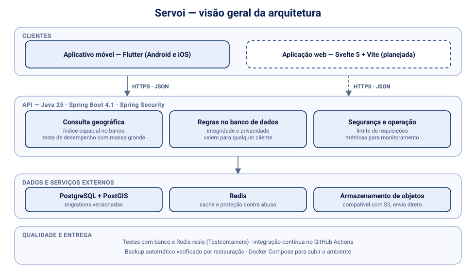
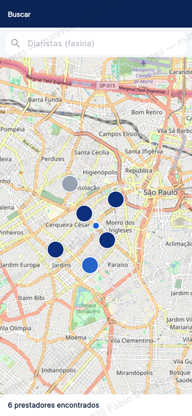
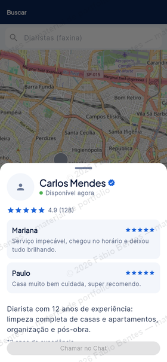

# Servoi — portfólio técnico

> Material de portfólio de **Fábio A. C. Bentes**. Descreve a **engenharia** do projeto Servoi, e não o produto.
> O código-fonte e as regras de negócio são privados. Posso apresentar o projeto em uma demonstração ao vivo.

## Sobre

O Servoi é um marketplace de serviços presenciais com busca geográfica, construído por mim a partir de três repositórios independentes: API, aplicativo móvel e aplicação web. Em desenvolvimento desde setembro de 2026.

## Competências demonstradas

| Área | O que o projeto exercita |
|---|---|
| **Backend** | Java 25, Spring Boot 4.1 (MVC), Spring Security, Maven |
| **Banco de dados** | PostgreSQL 17 com PostGIS, índice espacial, migrations versionadas com Flyway |
| **Consulta geográfica** | busca por raio com índice espacial e teste de desempenho com grande massa de dados |
| **Integridade e privacidade** | regras no próprio banco (restrições, gatilhos e papéis), valendo para qualquer cliente |
| **Segurança** | tokens de curta duração com renovação rotativa, hash de senha forte, login com Google, limite de requisições por IP, segredos só por variável de ambiente |
| **Concorrência** | corridas de dados encontradas, reproduzidas com testes de concorrência e corrigidas |
| **Cache e proteção** | Redis |
| **Integrações** | consulta de CEP e geocodificação, armazenamento de objetos compatível com S3 (envio direto do app) |
| **Mobile** | Flutter (Dart) |
| **Web** | Svelte 5 e Vite (planejado) |
| **Observabilidade** | Micrometer e Prometheus, com métricas protegidas |
| **Qualidade e entrega** | specs antes do código (mais de 30), ADRs, Testcontainers com banco e Redis reais, GitHub Actions, Docker Compose |
| **Disponibilidade** | backup automático verificado por restauração e soma de verificação de dados |

## Visão geral da arquitetura

## Decisões de engenharia

- **Regras no banco, não só na API:** integridade e privacidade ficam no PostgreSQL, e a API acessa o banco sem ser dona das tabelas, com privilégio mínimo.
- **Desempenho como requisito testável:** a busca geográfica tem teste de desempenho automatizado, e não só uma meta no papel.
- **Concorrência tratada com evidência:** cada corrida encontrada vira um teste que a reproduz antes da correção.
- **Backup que se prova:** a cópia de segurança só conta se for restaurada e verificada.
- **Três repositórios, um contrato:** o backend é a fonte de regras e do contrato para o celular e a web.
- **Decisões registradas:** mudanças relevantes viram ADR, e cada vertical tem especificação, plano e evidências de execução.

## Telas de exemplo

Capturas do aplicativo Flutter rodando contra uma API de demonstração, com dados **fictícios** e em baixa resolução.

| Busca | Ficha |
|:--:|:--:|
|  |  |

## Estado do projeto

Em desenvolvimento ativo. O backend está mais avançado que os clientes: o aplicativo móvel entrega parte das telas e a aplicação web ainda será construída. Este material descreve a engenharia, e nem todos os recursos do produto estão concluídos.

## Propriedade intelectual

O **Servoi-app** (repositórios `servoi-backend`, `servoi-mobile` e `servoi-web`) foi depositado no **Instituto Nacional da Propriedade Industrial (INPI)** como programa de computador (Lei nº 9.609/1998):

- **Processo INPI:** `512026009069-5` (protocolo `870260104986`, depositado em 10/10/2026)
- **Versão registrada:** 1.0.0, tag `inpi-v1.0.0` nos repositórios de código
- **Hash de integridade (SHA-512) do pacote com os três repositórios:** `d3038644788c50f24a1eaea58919fd75d3ad312214273f4deeee37eff1850a6f19af53a2d3c79d4483f8d13525d10b420037f9e0ed86872ee82e775c181c859a`
- **Consulta pública:** [busca.inpi.gov.br](https://busca.inpi.gov.br/pePI/), em Pesquisa Básica > Programa de Computador

---

© 2026 Fábio A. C. Bentes. Todos os direitos reservados. Veja [LICENSE](LICENSE).
